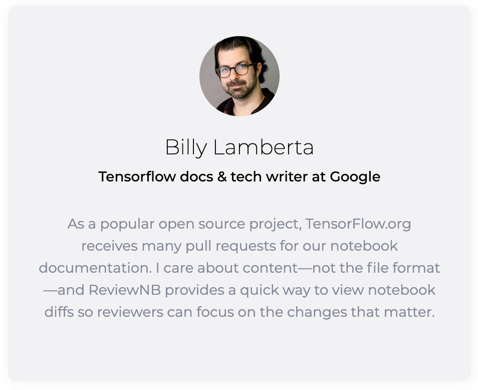
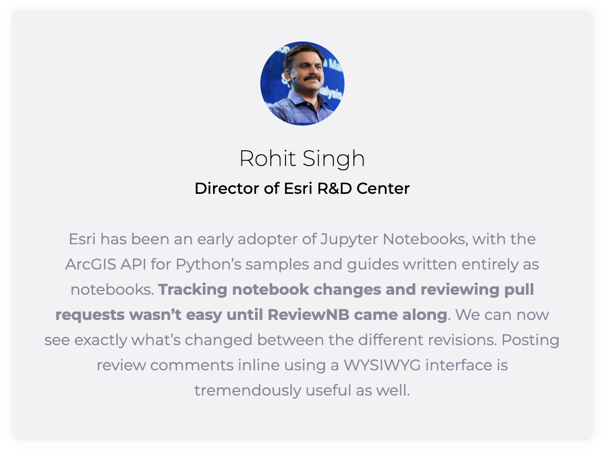

.. include:: globals.rst

Testimonials
======================

.. pull-quote::

    As a popular open source project, TensorFlow.org receives many pull requests for our notebook documentation. I care about content—not the file format—and ReviewNB provides a quick way to view notebook diffs so reviewers can focus on the changes that matter.

    -- Billy Lamberta, TensorFlow docs & tech writer at Google

.. pull-quote::

    Our MOOC and the full documentation of our open-source library is build from notebooks and we have a lot of contributors who help perfect them. ReviewNB has been a lifesaver to help us quickly see diffs and post comments whenever we ask for something to tweak in a specific cell.

    -- Sylvain Gugger, Research scientist at fast.ai

.. pull-quote::

    In our team at Microsoft, we have been using ReviewNB to review the Jupyter notebooks that we have in our open source repository https://github.com/Microsoft/Recommenders. ReviewNB has helped a lot to be more agile when doing code reviews.

    -- Miguel González-Fierro, Data Scientist at Microsoft

.. pull-quote::

    Esri has been an early adopter of Jupyter Notebooks, with the ArcGIS API for Python’s samples and guides written entirely as notebooks. Tracking notebook changes and reviewing pull requests wasn’t easy until ReviewNB came along. We can now see exactly what’s changed between the different revisions. Posting review comments inline using a WYSIWYG interface is tremendously useful as well.

    -- Rohit Singh, Director of Esri R&D Center

.. admonition:: More from the community

   More testimonials and community posts on `our homepage <https://www.reviewnb.com/#love>`_.
